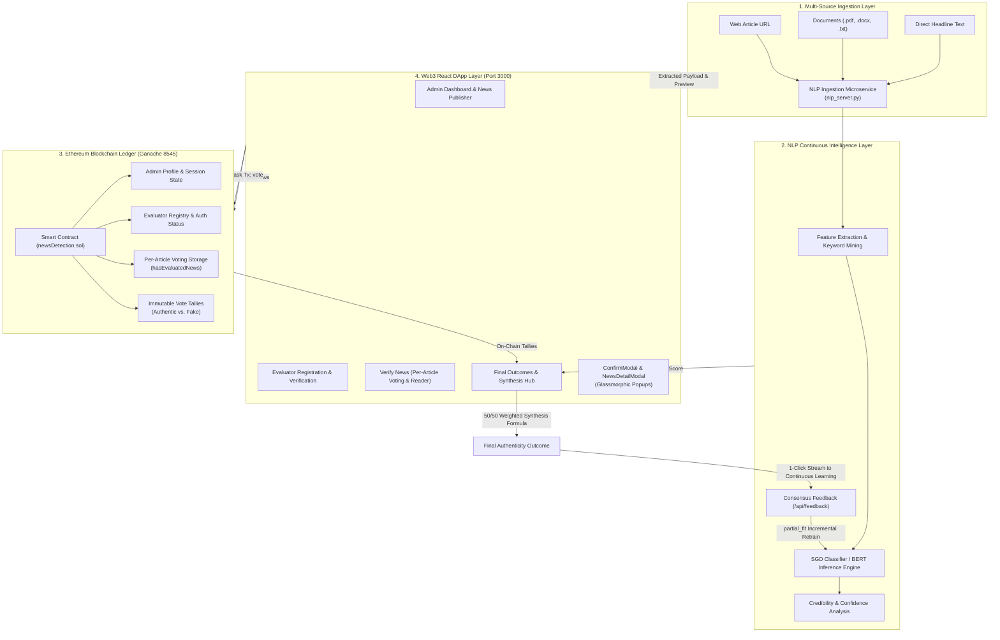

# Decentralized Framework for Misinformation Detection & Verification
### Synthesizing Natural Language Processing (Continuous Learning) and Human Expert Opinion (Ethereum Blockchain)

[](https://ethereum.org/)
[](https://soliditylang.org/)
[](https://trufflesuite.com/truffle/)
[](https://react.dev/)
[](https://tailwindcss.com/)
[](https://www.python.org/)
[](https://flask.palletsprojects.com/)
[](https://metamask.io/)

> 🛡️ **An End-to-End Decentralized Fact-Checking Ecosystem**: Built from scratch to synthesize Ethereum Smart Contract consensus with an adaptive, continuous-learning NLP classification engine.  
> **Repository:** [https://github.com/Ramakrishna61505/blockchain-mis-info.git](https://github.com/Ramakrishna61505/blockchain-mis-info.git)  
> **Author & Lead Developer:** Ramakrishna ([@Ramakrishna61505](https://github.com/Ramakrishna61505))

---

## 📑 Table of Contents
1. [Executive Summary & Problem Statement](#-executive-summary--problem-statement)
2. [System Architecture](#-system-architecture)
3. [Key Innovations & Features](#-key-innovations--features)
4. [Directory Structure](#-directory-structure)
5. [Prerequisites & System Requirements](#-prerequisites--system-requirements)
6. [Quick Start (One-Click Launcher)](#-quick-start-one-click-launcher)
7. [Manual Step-by-Step Installation & Execution](#-manual-step-by-step-installation--execution)
8. [MetaMask Wallet & Localhost Configuration](#-metamask-wallet--localhost-configuration)
9. [Smart Contract Specification (`newsDetection.sol`)](#-smart-contract-specification-newsdetectionsol)
10. [Troubleshooting & FAQs](#-troubleshooting--faqs)
11. [Project Information & Author](#-project-information--author)

---

## 💡 Executive Summary & Problem Statement

The viral diffusion of deceptive misinformation across social platforms, digital tabloids, and generative AI content presents a critical threat to public health, financial systems, and democratic institutions. Existing automated fact-checking models (such as static deep learning classifiers) suffer from:
- **Catastrophic Forgetting & Model Drift**: Static training datasets quickly become obsolete as fresh narrative domains emerge.
- **Black-box Opacity & Hallucinations**: Opaque neural networks provide probabilistic outputs without immutable evidence or accountability.
- **Centralized Moderation Bias**: Single-point fact-checking authorities are prone to censorship, editorial bias, and security breaches.

### The Solution: Hybrid Decentralized Verification
This framework realizes a **dual-layer consensus architecture**:
1. **Immutable Cryptographic Governance (Ethereum Smart Contract)**: Provides decentralized participant registration, transparent admin verification of professional credentials, and tamper-proof per-article voting recorded on-chain.
2. **Automated Continuous Learning NLP Service**: Uses incremental statistical classifiers (TF-IDF + SGD partial fit) and transformer models (BERT) to extract features, compute immediate credibility probabilities, and continuously adapt weights as human consensus is formed.
3. **Decentralized Synthesis Engine**: Combines **50% Human Crowd Consensus** and **50% Real-Time AI Confidence** into a verified authenticity outcome.

---

## 🏛 System Architecture



---

## 🚀 Key Innovations & Features

### 1. Multi-Source Content Extraction & Detection
- **Web Link Extraction**: Automated parsing of full article headlines, body paragraphs, and OpenGraph featured imagery (`og:image`) via BeautifulSoup.
- **Document Parsing**: Direct file upload support for `.pdf` (via `pypdf`), `.docx` (via `python-docx`), and `.txt`. Embedded illustrations and charts are automatically extracted to `/uploads/` and referenced on-chain.
- **Pre-Publication Inspection**: Admins can review extracted text, inspect detected media, and preview real-time AI predictions before spending gas to publish to Ethereum.

### 2. Independent Per-Article Evaluator Voting
- Previous decentralized voting contracts locked evaluators out after casting a single vote across the entire session.
- Our enhanced smart contract implements a nested ledger mapping:
  ```solidity
  mapping(uint256 => mapping(address => bool)) public hasEvaluatedNews;
  ```
- Evaluators can vote on **every published news article individually** (`#0`, `#1`, `#2`, etc.) exactly once, with live on-chain status tracking (`✓ Evaluated by You`).

### 3. Automatic Web3 Role Detection & Synchronization
- Seamless integration with MetaMask via `getWeb3.js`.
- Frontend automatically detects whether the active wallet is the **Administrator** (`admin`) or a registered **Evaluator**, adjusting navigation views and blocking unauthorized route access.
- Integrated **"🦊 Switch Account in MetaMask"** trigger buttons using EIP-2255 permissions (`wallet_requestPermissions`).

### 4. Glassmorphic Web3 Confirmation System
- Replaced all default browser popups (`window.alert` / `window.confirm`) with modern, animated glassmorphic modals (`ConfirmModal.js`).
- Dynamic verdict badges:
  - 🛡️ **`AUTHENTIC / REAL NEWS`** (Emerald badge with neon glow)
  - ⚠️ **`FAKE / MISINFORMATION`** (Crimson red badge with warning glow)
- Displays article statements, estimated gas advisories, and live spinner indicators during pending MetaMask signature states.

### 5. Interactive Full-Article Reader (`NewsDetailModal.js`)
- Dedicated reader accessible to both Admins and Evaluators.
- Displays full headlines, formatted body paragraphs, high-resolution media figures, source badges, and clickable original web links.

### 6. Closed-Loop Continuous NLP Learning
- Final consensus outcomes reached by crowd evaluators can be streamed directly into the Python NLP microservice with a single click (**"🔄 Feed Consensus into Continuous NLP"**).
- The model executes an online gradient update (`partial_fit`) on `SGDClassifier`, learning newly verified terminology and persisting updates to `continuous_learning_data.json`.

---

## 📂 Directory Structure

```text
├── contracts/                        # Ethereum Solidity Smart Contracts
│   ├── Migrations.sol                # Truffle migration state tracking
│   └── newsDetection.sol             # Core fact-checking smart contract
├── migrations/                       # Deployment scripts for Truffle
│   ├── 1_initial_migration.js        # Deploy Migrations contract
│   └── 2_deploy_contracts.js         # Deploy newsDetection contract
├── nlp_server.py                     # Python Flask Microservice (Inference & Continuous Learning)
├── NLP/                              # NLP datasets, notebooks, and model artifacts
│   ├── BERT_Evaluation.ipynb         # Transformer evaluation notebook
│   ├── continuous_learning_data.json # Historical fine-tuning logs
│   └── news_data/                    # Sample corpora & test datasets
├── app/                              # React.js Frontend DApp
│   ├── public/
│   │   ├── uploads/                  # Extracted document images (.png/.jpg)
│   │   └── index.html                # HTML template
│   ├── src/
│   │   ├── component/
│   │   │   ├── Admin/AddNews/        # News publisher (Direct text, URL scraper, File extraction)
│   │   │   ├── Voting/               # Evaluator portal (Per-article voting & cards)
│   │   │   ├── Registration/         # Evaluator on-chain identity registration
│   │   │   ├── Verification/         # Admin authorization portal for evaluators
│   │   │   ├── Final_Outcomes/       # 50/50 Human-AI synthesis hub & retrain trigger
│   │   │   ├── Navbar/               # Role-aware responsive navigation bars
│   │   │   ├── ConfirmModal.js       # Glassmorphic Web3 confirmation dialogs
│   │   │   └── NewsDetailModal.js    # Full article & media inspection modal
│   │   ├── contracts/                # Compiled Truffle ABI artifacts (newsDetection.json)
│   │   ├── getWeb3.js                # Web3 & MetaMask provider initialization
│   │   ├── App.js                    # React Router configuration
│   │   └── index.css                 # Tailwind CSS & keyframe animations
│   ├── package.json                  # React dependencies
│   └── tailwind.config.js            # Tailwind styling config
├── truffle-config.js                 # Network (8545) & Solidity 0.5.16 compiler settings
├── run.bat                           # Interactive multi-process CLI launcher
├── HOW_TO_RUN.md                     # Step-by-step setup walkthrough
└── README.md                         # Project documentation
```

---

## 💻 Prerequisites & System Requirements

Ensure the following runtimes and packages are installed on your machine:

| Software / Tool | Recommended Version | Purpose |
| :--- | :--- | :--- |
| **Node.js** | `v16.x` – `v20.x` | Truffle execution & React runtime |
| **npm** | `v8.x` or higher | Dependency package manager |
| **Truffle Suite** | `v5.11.5` | Smart contract compilation and EVM deployment |
| **Ganache** | CLI (`ganache`) or GUI | Local private Ethereum blockchain (`127.0.0.1:8545`) |
| **MetaMask** | Browser Extension | Web3 wallet, key management, and tx signing |
| **Python** | `3.8` – `3.11` | NLP microservice, text scraping & ML models |

---

## ⚡ Quick Start (One-Click Launcher)

For Windows users, an interactive batch launcher is provided at the root of the repository:

1. Double-click **`run.bat`** (or execute in terminal):
   ```cmd
   .\run.bat
   ```
2. Type **`A`** and hit **Enter**:
   ```text
   ==========================================================
    Fake News Detection (Blockchain + NLP) - Quick Launcher
   ==========================================================

   Select an option:
   [A] Launch ALL Services (Ganache + NLP Server + React App in separate windows)
   [1] Start Local Ganache Blockchain (Port 8545)
   [2] Compile and Deploy Smart Contracts (Truffle Migrate)
   [3] Install React Frontend Dependencies (app/npm install)
   [4] Start React Frontend Web Application (app/npm start)
   [5] Start Python NLP Backend Server (Port 5000)
   [6] Open HOW_TO_RUN.md Documentation
   [7] Exit
   ```
3. The launcher will automatically boot:
   - **Window 1**: Ganache Local Blockchain on `http://127.0.0.1:8545` (Network ID `5777`).
   - **Window 2**: Python NLP Microservice on `http://127.0.0.1:5000`.
   - **Window 3**: React Webpack Dev Server on `http://localhost:3000`.

---

## 🛠 Manual Step-by-Step Installation & Execution

### 1. Clone the Repository
```bash
git clone https://github.com/Ramakrishna61505/blockchain-mis-info.git
cd blockchain-mis-info
```

### 2. Start the Local Ganache Blockchain
In a separate terminal window:
```bash
npx ganache --port 8545 --chain.networkId 5777
```
> ⚠️ **Important**: Note the first two generated accounts:
> - **Account 0** will serve as the **Administrator / Contract Deployer**.
> - **Account 1** will serve as the **Evaluator / Fact-Checker**.

### 3. Compile & Migrate Smart Contracts
In the root directory, compile the contracts and deploy to Ganache:
```bash
# On Windows PowerShell:
$env:APPDATA = "$pwd\.truffle_data"
npx truffle compile
npx truffle migrate --reset
```
*Truffle will compile `newsDetection.sol` with solc `0.5.16` and export updated ABI artifacts into `app/src/contracts/newsDetection.json`.*

### 4. Install & Launch the Python NLP Microservice
In a separate terminal window:
```bash
# Install Python microservice requirements
pip install flask flask-cors requests scikit-learn numpy beautifulsoup4 pypdf python-docx lxml

# Launch the microservice
python nlp_server.py
```
*The server will start listening on `http://127.0.0.1:5000` with active health checks.*

### 5. Install & Run the React DApp
In a separate terminal window:
```bash
cd app
npm install --legacy-peer-deps

# Start React Dev Server (with OpenSSL legacy provider flag)
set NODE_OPTIONS=--openssl-legacy-provider   # On Windows CMD
# or: $env:NODE_OPTIONS="--openssl-legacy-provider"  # On Windows PowerShell
npm start
```
*The DApp will open automatically in your default browser at `http://localhost:3000`.*

---

## 🦊 MetaMask Wallet & Localhost Configuration

1. **Install the MetaMask Extension** from [metamask.io](https://metamask.io).
2. **Add the Localhost Ganache Network**:
   - Open MetaMask -> Settings -> **Networks** -> **Add a Network Manually**.
   - **Network Name**: `Ganache Localhost`
   - **New RPC URL**: `http://127.0.0.1:8545`
   - **Chain ID**: `5777` (or `1337` depending on Ganache version)
   - **Currency Symbol**: `ETH`
   - Click **Save** and switch to this network.
3. **Import Ganache Test Accounts**:
   - In your Ganache console, locate the private keys for **Account (0)** and **Account (1)**.
   - In MetaMask -> Profile Icon -> **Import Account** -> Paste Private Key.
   - Label Account 0 as **`Admin Acc`** (has ~1,000 ETH).
   - Label Account 1 as **`Evaluator Acc`** (has ~1,000 ETH).

---

## 📜 Smart Contract Specification (`newsDetection.sol`)

- **Solidity Version**: `^0.5.16`
- **Compiler Optimization**: 200 runs enabled
- **Network ID**: `5777`

### Key Data Structures
```solidity
struct News {
    uint256 newsId;
    string newsPost;        // JSON metadata string containing headline, body, image URL, source
    uint256 voteCount;      // Count of authentic votes
    uint256 fakeCount;      // Count of fake/misinformation votes
    uint256 votePercetage;
}

struct Evaluator {
    address evaluatorAddress;
    string name;
    string idn;
    string profession;
    bool isVerified;        // Authorized by Administrator
    bool hasVoted;          // Has evaluated at least one article
    bool isRegistered;
}
```

### Core Functions
| Function | Access | Description |
| :--- | :--- | :--- |
| `setnewsDetectionDetails(...)` | `onlyAdmin` | Sets admin credentials, names the round, and starts evaluation (`start = true`). |
| `addNews(string _newsPost)` | `onlyAdmin` | Appends a new structured news record to `newsDetails`. |
| `registerAsEvaluator(...)` | Public | Submits evaluator credentials (Name, ID, Profession) for admin authentication. |
| `verifyEvaluator(bool, address)` | `onlyAdmin` | Approves or revokes an evaluator's voting privileges. |
| `vote(uint256 newsId, bool isFake)` | Verified Evaluator | Records an immutable vote for a specific news article. Enforces single vote per article. |
| `hasEvaluatorVoted(newsId, address)` | Public View | Returns `true` if the evaluator address has already cast a vote for `newsId`. |
| `endnewsDetection()` | `onlyAdmin` | Concludes the active round, preventing any subsequent voting transactions. |

---

## ❓ Troubleshooting & FAQs

#### 1. "Transaction has been reverted by the EVM" when voting
- **Cause**: The evaluator wallet has already voted on that specific news article, or the contract on Ganache was deployed with the older single-vote code.
- **Fix**: Run `npx truffle migrate --reset` to ensure the updated `hasEvaluatedNews` mapping is deployed, and ensure the session is active (`start == true`).

#### 2. "Failed to fetch" or "500 Internal Server Error" during Link/Document extraction
- **Cause**: The Python NLP service (`nlp_server.py`) is offline.
- **Fix**: Run `python nlp_server.py` in a separate terminal or select Option `[5]` in `run.bat`. Confirm `http://127.0.0.1:5000/api/health` returns status `online`.

#### 3. Error: `digital envelope routines::unsupported` (`ERR_OSSL_EVP_UNSUPPORTED`)
- **Cause**: Node.js v17+ OpenSSL 3.0 compatibility behavior with legacy Webpack.
- **Fix**: Launch React with the OpenSSL legacy provider flag:
  ```powershell
  $env:NODE_OPTIONS = "--openssl-legacy-provider"
  npm start
  ```

#### 4. Truffle compilation error: `EPERM: operation not permitted` on config.json
- **Cause**: Truffle analytics attempting to access the Windows roaming directory.
- **Fix**: Set a local AppData path before compiling:
  ```powershell
  $env:APPDATA = "$pwd\.truffle_data"
  truffle compile
  ```

#### 5. MetaMask shows "Nonce too high" or transaction hangs
- **Cause**: Ganache was restarted and the account transaction nonce on-chain reset to `0`, while MetaMask still remembers a higher nonce.
- **Fix**: In MetaMask -> Settings -> Advanced -> Click **Clear activity and nonce data** (or **Reset Account**).

---

## 📄 Project Information & Author

- **Creator & Lead Developer**: Ramakrishna ([@Ramakrishna61505](https://github.com/Ramakrishna61505))
- **Project Type**: Final Year Engineering Project / Capstone System Architecture
- **License**: MIT License — open for academic, educational, and research extension.
